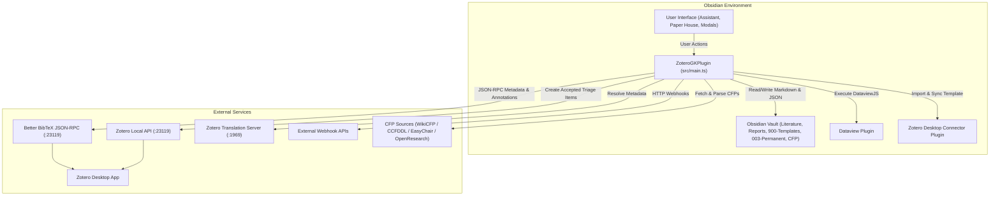
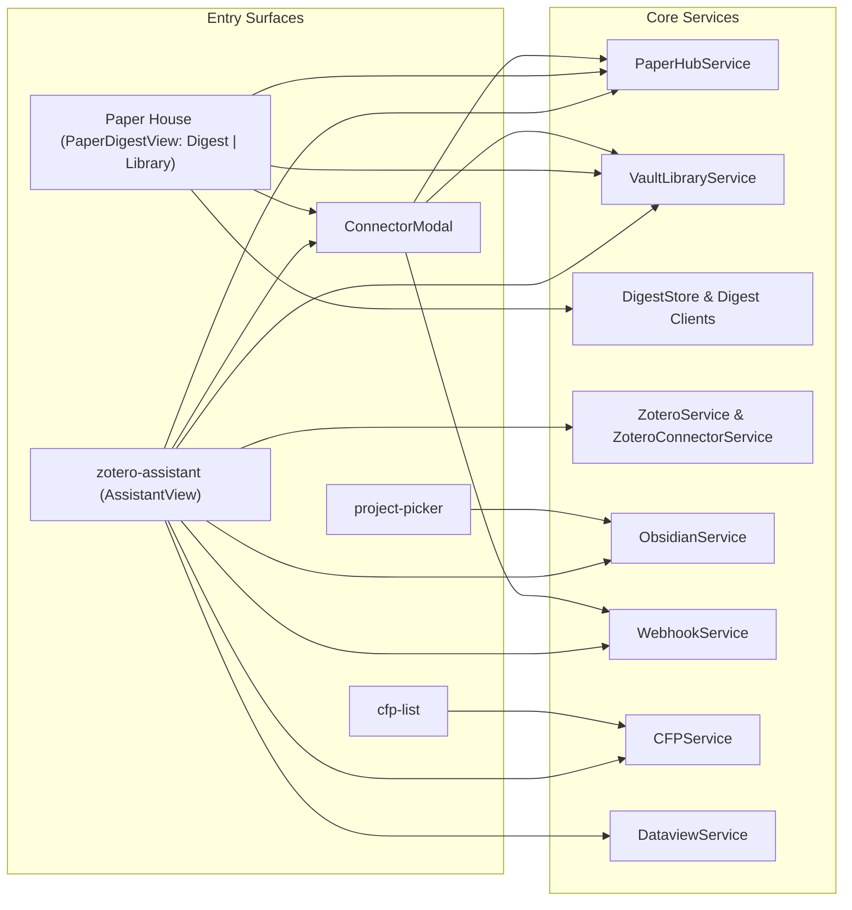
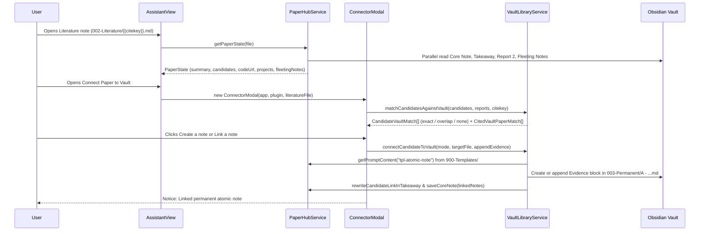
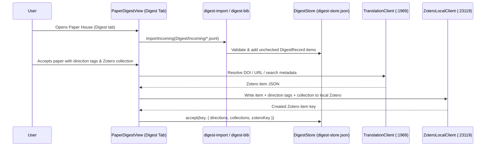
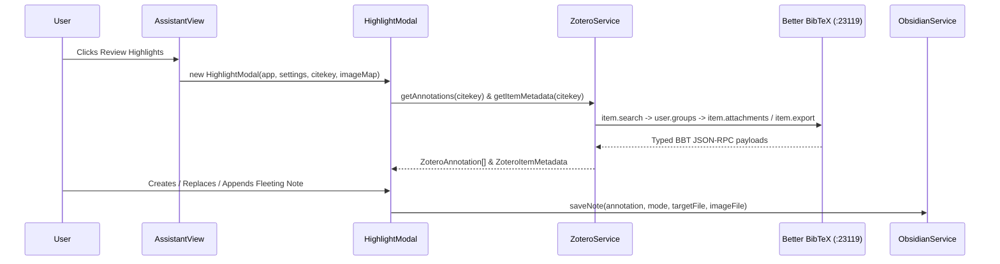

# Architecture & Code Structure

This document describes the architecture, code organization, typed data structures, and data flow of the Zotero Annotation Reviewer plugin.

---

## File Structure

```
zotero-annotation-reviewer/
├── src/
│   ├── main.ts                       # Plugin entry point, registers views, code blocks, and commands
│   ├── types.ts                      # Domain TypeScript interfaces, defaults, and built-in templates/prompts
│   ├── settings.ts                   # Tabbed settings UI with CodeMirror 6 editors
│   ├── styles.css                    # Source CSS stylesheet bundled into root styles.css
│   │
│   ├── services/                     # Core domain and external integration services
│   │   ├── paper-hub.ts              # Paper Workspace paths, Report 1/2/Takeaway/Core Note & 900-Templates/
│   │   ├── vault-library.ts          # Vault Literature indexing, search, and atomic-note linking
│   │   ├── digest-types.ts           # Paper Digest types, defaults, and HTTP/file abstractions
│   │   ├── digest-store.ts           # digest-store.json state machine (unchecked/accepted/rejected)
│   │   ├── digest-import.ts          # Incoming JSONL validation and batch ingestion
│   │   ├── digest-bib.ts             # BibTeX-to-DigestInput converter
│   │   ├── digest-translate.ts       # Zotero Translation Server client
│   │   ├── digest-zotero.ts          # Zotero Local API client for item/tag/collection creation
│   │   ├── zotero.ts                 # Zotero Better BibTeX JSON-RPC client
│   │   ├── zotero-connector.ts       # Obsidian Zotero Desktop Connector integration & template sync
│   │   ├── obsidian.ts               # Fleeting/Literature note CRUD via markdown-note-orm
│   │   ├── dataview.ts               # Optional DataviewJS execution wrapper
│   │   ├── webhook.ts                # Modular HTTP webhook execution and template substitution
│   │   ├── cfp.ts                    # CFP service orchestrator, series notes, and conference matching
│   │   ├── cfp-core.ts               # Local CORE.csv conference rank parser
│   │   ├── cfp-ccfddl.ts             # CCFDDL allconf.yml YAML parser and CCF rank index
│   │   ├── cfp-wikicfp.ts            # WikiCFP HTML parser
│   │   ├── cfp-wikicfp-series.ts     # WikiCFP Conference Series A–Z index parser
│   │   ├── cfp-easychair.ts          # EasyChair HTML parser
│   │   └── cfp-openresearch.ts       # OpenResearch HTML parser
│   │
│   ├── ui/                           # Obsidian views, modals, and code block renderers
│   │   ├── assistant.ts              # zotero-assistant Paper Workspace & annotation dashboard
│   │   ├── connector-modal.ts        # Vault Knowledge Connector modal for atomic Zettel linking
│   │   ├── digest-view.ts            # Paper House popout view ([Digest | Library] tabs)
│   │   ├── digest-settings.ts        # Paper Digest settings panel
│   │   ├── highlights.ts             # Zotero annotation review and metadata verification modal
│   │   ├── webhook-modals.ts         # WebhookSelectionModal and WebhookInputValueModal
│   │   ├── project-selector.ts       # project-picker code block renderer
│   │   ├── cfp-list-view.ts          # cfp-list code block renderer
│   │   ├── cfp-list-modal.ts         # CFP list display modal
│   │   ├── cfp-manual-modal.ts       # Manual CFP creation modal
│   │   └── inputs.ts                 # Citation key prompt modal
│   │
│   └── utils/                        # Pure utility helpers
│       ├── parser.ts                 # Windows-safe JSON image map parser
│       ├── paths.ts                  # Vault-relative path normalizer
│       └── series.ts                 # Conference series acronym normalizer
│
├── tests/                            # Jest + ts-jest test suites and Obsidian API mocks
├── docs/                             # Published developer documentation
│   ├── ARCHITECTURE.md               # System architecture and module guide
│   ├── DEBUGGING.md                  # Debugging and testing guide
│   └── assets/                       # PlantUML architecture and sequence diagrams
├── pkm/                              # Project brief, feature requirements, and backlog specs
│   ├── project-brief.md              # Engineering objectives, module map, and layout adaptations
│   └── *.md                          # Feature requirement and backlog specifications
│
├── esbuild.config.mjs                # esbuild bundler configuration (outputs root main.js & styles.css)
├── eslint.config.mjs                 # ESLint flat configuration (strict TypeScript, zero explicit any)
├── jest.config.js                    # Jest test runner configuration
├── tsconfig.json                     # TypeScript strict compiler configuration
├── package.json                      # Package metadata, scripts, and dependencies
└── manifest.json                     # Obsidian plugin manifest
```

---

## System Architecture

### High-Level Architecture Flow



### Component Interaction Flow



---

## Data Flow

### 1. Paper Workspace, Synthesis & Vault Knowledge Connector Flow



### 2. Paper House Digest Triage Flow



### 3. Reviewing Zotero Annotations (`HighlightModal`)



---

## Key Modules

### 1. Main Plugin (`src/main.ts`)

**Responsibility:** Plugin lifecycle management, settings migration, code block registration (`zotero-assistant`, `project-picker`, `cfp-list`), command palette registration, background CFP refresh scheduling, Vault template materialization (`ensureBuiltinTemplatesInVault`), and lazy registration of `Paper House` (`registerDigest`).

---

### 2. PaperHubService (`src/services/paper-hub.ts`)

**Responsibility:** Manages per-paper workspace state and Vault-backed templates/prompts.

- Resolves citekey-parameterized paths across `PaperWorkspaceConfig` (`002-Literature/{{citekey}}.md`, Report 1 Deep Research, Report 2 External Landscape, Takeaway, and Core Note).
- Batches file reads with `Promise.all` to construct `PaperState`, automatically extracting `"code_url"` from Report 2 into Literature note frontmatter when missing.
- Parses Takeaway inline `Research Profile` fields (`TL;DR`, `topic`, `position`, `contributions`, `novelty`, `limitation`) and `### Candidate` atomic note blocks.
- Synchronizes built-in and user-defined templates and prompts as Markdown files inside `900-Templates/`.

---

### 3. VaultLibraryService (`src/services/vault-library.ts`) & ConnectorModal (`src/ui/connector-modal.ts`)

**Responsibility:** Indexes primary Literature notes across the Vault and links paper insights to permanent Zettelkasten notes.

- `listLiteraturePapers()` and `searchPapers()` provide weighted multi-token search across citekey, title, venue series, authors, year, projects, tags, Core Notes, and Takeaway summaries.
- `findSameVenuePapers()` discovers sibling papers in the same normalized conference/journal series.
- `matchCandidatesAgainstVault()` and `connectCandidateToVault()` power `ConnectorModal` to match candidate atomic concepts against `003-Permanent/` (exact title or concept token overlap), create or reuse atomic notes from `tpl-atomic-note`, append `Evidence from [[citekey]]` sections, rewrite Takeaway candidate links, and update Core Note `linked-notes`.

---

### 4. Paper House (`src/ui/digest-view.ts`, `src/ui/digest-settings.ts`, `src/services/digest-*.ts`)

**Responsibility:** Desktop popout window (`zotero-paper-digest`) unifying incoming paper triage (`Digest` tab) and Vault literature exploration (`Library` tab).

- `DigestStore` (`digest-store.ts`) persists `unchecked`, `accepted`, and `rejected` records plus validation errors in `digest-store.json` with configurable retention cleanup and batch withdrawal.
- `digest-import.ts` and `digest-bib.ts` ingest `*.jsonl` drops from `Digest/Incoming` and `.bib` BibTeX imports.
- `TranslationClient` (`digest-translate.ts`) and `ZoteroLocalClient` (`digest-zotero.ts`) resolve bibliographic metadata via Zotero Translation Server and create tagged Zotero items in local Zotero collections.

---

### 5. AssistantView (`src/ui/assistant.ts`)

**Responsibility:** Renders the `zotero-assistant` code block inside Literature notes as an interactive Paper Workspace and annotation dashboard, integrating metadata chips, Report 1 / Report 2 / Takeaway / Core Note tabs, `ConnectorModal`, `HighlightModal`, project linking, CFP conference context (with CCF/CORE rank badges), webhook triggers, and optional DataviewJS scripts.

---

### 6. ZoteroService (`src/services/zotero.ts`) & ZoteroConnectorService (`src/services/zotero-connector.ts`)

**Responsibility:** Typed communication with Zotero Desktop and Obsidian Zotero Desktop Connector.

- `ZoteroService` queries Better BibTeX JSON-RPC (`http://127.0.0.1:23119/better-bibtex/json-rpc`) using typed response interfaces (`BbtExportItem`, `BbtAttachment`, `BbtAnnotation`, `BbtSearchHit`, `BbtGroup`) without `any`.
- `ZoteroConnectorService` triggers Zotero Integration imports and loads/saves the Zotero note template (`900-Templates/zotero-note-template.md`).

---

### 7. WebhookService (`src/services/webhook.ts`) & Webhook Modals (`src/ui/webhook-modals.ts`)

**Responsibility:** Executes HTTP webhooks with recursive JSON, form, or text template filling (`{{filename}}`, `{{path}}`, `{{content}}`, `{{timestamp}}`, `{{frontmatter.*}}`, `{{citekey}}`, `{{path.*}}`, `{{prompt.*}}`), `secretStorage` header lookup, and interactive prompts via `WebhookSelectionModal` and `WebhookInputValueModal`.

---

### 8. CFPService (`src/services/cfp.ts`, `src/services/cfp-*.ts`)

**Responsibility:** Orchestrates Call-for-Papers fetching, parsing, Series note generation, CCF/CORE rank enrichment (`cfp-ccfddl.ts` + `cfp-core.ts`), and conference matching for Literature notes.

---

### 9. ObsidianService (`src/services/obsidian.ts`) & DataviewService (`src/services/dataview.ts`)

**Responsibility:** `ObsidianService` manages Fleeting/Literature notes via `markdown-note-orm` and resolves local annotation images by key or PDF bounding-box coordinates; `DataviewService` wraps the optional Dataview plugin's `executeJs` API with typed `DataviewApi` narrowing.

---

## Data Structures

### Core Types (`src/types.ts`)

**ZoteroAnnotationPosition & ZoteroAnnotation:**
```typescript
export interface ZoteroAnnotationPosition {
	pageIndex?: number;
	rects?: number[][];
	[key: string]: unknown;
}

export interface ZoteroAnnotation {
	key: string;
	citationKey: string;
	type: 'highlight' | 'image' | 'ink' | 'note' | 'unknown';
	text: string;
	comment: string;
	color: string;
	pageLabel: string;
	link: string;
	attachmentTitle: string;
	date: string;
	position?: ZoteroAnnotationPosition | string | null;
}
```

**ZoteroItemMetadata:**
```typescript
export interface ZoteroItemMetadata {
	key: string;
	itemType: string;
	title: string;
	creators: string[];
	date: string;
	publication: string;
	doi: string;
	url: string;
	abstract: string;
	tags: string[];
	zoteroNotes: unknown[];
	volume?: string;
	issue?: string;
	pages?: string;
	publisher?: string;
}
```

**PaperWorkspaceConfig:**
```typescript
export interface PaperWorkspaceConfig {
	literatureNotePath: string;
	report1Path: string;
	report2Path: string;
	takeawayPath: string;
	coreNotePath: string;
	highlightNotesFolder: string;
	atomicNotesFolder: string;
	templatesFolder: string;
	report1Label: string;
	report2Label: string;
	takeawayLabel: string;
}
```

---

## Settings Management

Settings are persisted via Obsidian's `loadData()` / `saveData()` APIs under `MyPluginSettings` and edited in `src/settings.ts` (plus `src/ui/digest-settings.ts`):

- **General & Zotero:** Zotero port, Fleeting Notes folder, metadata verification mapping, citation/annotation frontmatter keys, and optional legacy DataviewJS script.
- **Paper Workspace:** Citekey path patterns for Literature notes, Report 1, Report 2, Takeaway, Core Note, Highlight notes, Permanent Atomic notes (`003-Permanent`), and Templates folder (`900-Templates`).
- **Templates & Prompts:** Vault-backed Markdown templates (`tpl-report1`, `tpl-report2`, `tpl-takeaway`, `tpl-core-note`, `tpl-atomic-note`, `zotero-note-template.md`) and synthesis prompts (`synthesize`, `report1`, `report2`) with CodeMirror 6 editors.
- **Paper Digest:** Incoming folder, Translation Server URL, direction vocabulary, reject reasons, retention days, ribbon toggle, and Zotero Local API key (`secretStorage` preferred).
- **Projects & Webhooks:** Projects folder, `projectFrontmatterKey`, `projectIdKey`, webhook profiles, ribbon toggle, and debug mode.
- **CFP:** CFP folder, default tags, WikiCFP/CCFDDL/EasyChair/OpenResearch URLs, Series index letters, refresh intervals, `cfpAcronymKey`, `cfpCoreCsvPath`, and `cfpCcfddlLocalPath`.

---

## Build Process

1. **Strict Type Checking:** `npm run typecheck` (`tsc -noEmit -skipLibCheck`) verifies `src/**/*.ts` and `tests/**/*.ts` under `strict: true`.
2. **Bundling:** `node esbuild.config.mjs production` bundles `src/main.ts` and `src/styles.css` into root `main.js` and `styles.css`.
3. **External Dependencies:** `obsidian`, `electron`, `@codemirror/*`, `@lezer/*`, and Node built-in modules are marked external for the Obsidian runtime.

---

## Testing Architecture

- **Test Location:** Top-level `tests/` directory (`tests/**/*.test.ts`), cleanly separated from production `src/`.
- **Test Runner:** Jest with `ts-jest` in the `jsdom` environment, configured in `jest.config.js`.
- **Lint & Type Gates:** Both `src/**/*.ts` and `tests/**/*.ts` are checked by `npm run lint` (`@typescript-eslint/no-explicit-any: "error"`) and `npm run typecheck`.

---

## Extension Points

### Workspace Views
- `zotero-paper-digest` (`PaperDigestView`) – Desktop popout **Paper House** window with `[Digest | Library]` tabs.

### Code Block Processors
- `zotero-assistant` – Interactive Paper Workspace and Zotero annotation dashboard.
- `project-picker` – Project `Dashboard.md` linking UI.
- `cfp-list` – Upcoming and historical CFP table view.

### Commands
- `open-paper-digest` – Open Paper House (Digest tab, desktop only).
- `open-paper-library` – Open Paper House directly on the Vault Paper Library tab (desktop only).
- `zotero-trigger-webhook` – Trigger a configured webhook for the active note.
- `cfp-refresh` – Refresh CFP URL sources.
- `cfp-add-manual` – Add a manual CFP note.
- `cfp-show-list` – Open the CFP list modal.
- `cfp-refresh-wikicfp-series` – Refresh WikiCFP Conference Series index (A–Z).
- `cfp-refresh-this-series` – Refresh events for the active CFP Series note.

### Window API
- `window.__ZoteroAnnotationReviewerCFP.refreshSeries(programUrl, seriesAcronym)` – Exposed for DataviewJS buttons inside CFP Series notes and cleaned up on plugin unload.

---

## Security Considerations

1. **Secret Management:** Webhook header secrets and Zotero Local API keys use Obsidian `secretStorage` when available rather than plain-text Vault files.
2. **Safe Template Filling:** JSON webhook payloads use recursive object substitution (`fillTemplateRecursive`) before serialization to prevent malformed JSON injection.
3. **Vault Path Normalization:** All Vault-relative paths pass through `normalizePath()` and filename sanitization before file creation or modification.
4. **Polite Crawling:** CFP scrapers enforce request delays and staggered daily Series refresh intervals (>= 30 minutes) to respect upstream servers.
